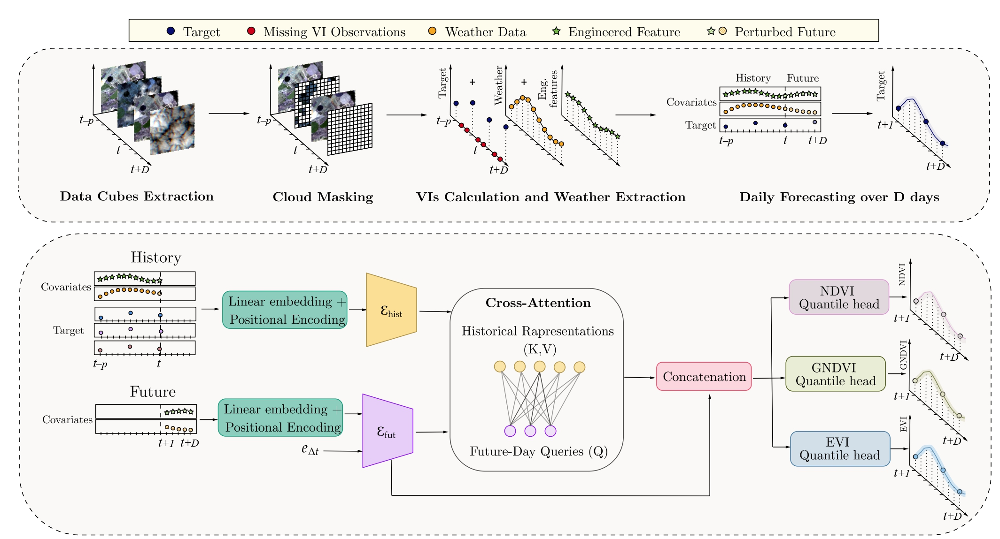

<div align="center">
<h1>Probabilistic Vegetation Health Forecasting Across Europe from Sparse Clear-Sky Satellite Time Series</h1>

[Irene Iele](https://scholar.google.com/citations?user=srLH7lkAAAAJ&hl=it&oi=ao)<sup>1</sup>,
[Paolo Soda](https://scholar.google.com/citations?user=E7rcYCQAAAAJ&hl=it&oi=ao)<sup>1,2</sup>,
[Matteo Tortora](https://matteotortora.github.io)<sup>3</sup>

<sup>1</sup> University Campus Bio-Medico of Rome,
<sup>2</sup> Umeå University,
<sup>3</sup> University of Genoa
</div>

## Overview

This repository contains the code and the pretrained weights of a dual-branch Transformer that forecasts
**NDVI, GNDVI and EVI jointly** over European cropland, with **quantile (q0.1, q0.5, q0.9) uncertainty**, from
sparse clear-sky Sentinel-2 time series and daily weather. The data come from the
[GreenEarthNet](https://github.com/vitusbenson/greenearthnet) minicubes: for each minicube, the VIs are averaged
over cropland pixels on clear-sky acquisition days and paired with daily meteorological covariates.

<div align="center">
  
</div>

**Model.** The *history branch* encodes the daily history window (weather, calendar features and the VI values,
which are available only on clear-sky days). The *future branch* encodes the daily future weather with **causal
attention**, so the representation of day *d* uses weather up to day *d* only. Each future day becomes a query
enriched with an **embedding of the days elapsed since the last observation (Δt)**, retrieves context from the
history through **cross-attention**, and feeds one quantile head per VI. The model thus forecasts every day of a
calendar grid. During training and evaluation, the loss and the metrics are computed at the next three clear-sky
acquisitions, whose dates are never given as input.

## Repository structure

```
vegetation_forecasting/
├── veg_forecast/                 # Python package
│   ├── model.py                  # VegForecaster + pinball loss
│   ├── layers.py                 # positional encoding
│   ├── constants.py              # column names, targets, masked future features
│   ├── metrics.py                # MAE, RMSE, WMAPE, MASE, pinball, CRPS, coverage, interval width
│   ├── inference.py              # load the released weights, forecast a cache
│   └── data/
│       ├── cache_builder.py      # CSV -> windowed cache (.npz/.json per tile) + scaler.json (NumPy/pandas only)
│       ├── dataset.py            # PyTorch dataset: engineered features, scaling, future-feature masking
│       ├── collate.py            # padding / masks for variable-length windows
│       ├── scaler.py             # standardization + arcsinh scaler
│       └── splits.py             # temporal internal train/validation split
├── scripts/
│   ├── fix_timeseries.py         # recompute the VI columns of the CSVs from the raw cubes (data corrections)
│   ├── build_cache.py            # build the cache of one split
│   ├── train.py                  # training (defaults = released model)
│   └── predict.py                # forecasts + metrics on one split
├── weights/                      # released model (seed 42)
│   ├── model.pt                  # state dict
│   ├── config.json               # architecture, feature order, training configuration
│   ├── scaler.json               # training feature/target statistics
│   └── feature_engineering_stats.json
├── metadata/tile_metadata.csv    # per-tile cropland share (training filter) and Köppen–Geiger climate
├── tests/                        # smoke tests on synthetic data
└── assets/                       # figures
```

## Installation

```bash
git clone https://github.com/arco-group/vegetation_forecasting.git
cd vegetation_forecasting
pip install -r requirements.txt     # or: pip install -e ".[fix,test]"
python -m pytest -q                 # smoke tests (synthetic data, CPU, about a minute)
```

## Quick start: forecasting with the released model

```python
from veg_forecast.inference import load_pretrained, load_dataset, predict

model, config = load_pretrained("weights")                # VegForecaster in eval mode
dataset = load_dataset("data/cache/val", "weights")       # a cache built with scripts/build_cache.py
quantiles = predict(model, dataset)                       # (windows, 3 targets, 3 VIs, 3 quantiles), raw VI units
```

or, from the command line, with the evaluation metrics:

```bash
python scripts/predict.py --cache-dir data/cache/val --out predictions/val.npz
```

`predictions/val.npz` contains the quantile forecasts, the observed targets and the target dates. The metrics are
written to `predictions/val.metrics.json`.

## Data pipeline

### 1. Time-series CSVs

The pipeline starts from one CSV per GreenEarthNet minicube, with one row per day:

| Column | Content |
| --- | --- |
| `time` | date (daily rows) |
| `wind`, `humidity`, `solar_irradiance`, `rainfall`, `pressure`, `avg_temperature`, `min_temperature`, `max_temperature` | daily weather (from the minicube) |
| `thick_clouds`, `thin_clouds`, `clouds_shadows` | cloud fractions of the acquisition (history only, see below) |
| `{avg,std,Q1,Q2,Q3}_{NDVI,GNDVI,EVI,RVI,SAVI}_{all,no_thick,no_clouds,clear_sky}` | VI statistics over cropland pixels, empty on days without a valid acquisition |

The model uses `avg_NDVI_clear_sky`, `avg_GNDVI_clear_sky` and `avg_EVI_clear_sky`. The other VI columns are
dropped. Training CSVs are stored as `<split>/<tile>/<cube>.csv`. Test CSVs are stored as
`<split>/<season>/minicube_<i>_<tile>_<lat>_<lon>.csv`, matching the GreenEarthNet layout. The CSVs themselves are
not distributed in this repository.

### 2. Data corrections (`scripts/fix_timeseries.py`)

The VI columns used for the results of the paper were recomputed from the raw GreenEarthNet cubes with three
corrections:

1. **Sentinel-2 processing baseline 04.00.** For acquisitions from 25 January 2022, the +0.1 radiometric offset
   introduced by ESA is not removed in GreenEarthNet. This affects about half of the temporal and spatio-temporal OOD
   test acquisitions. The offset is subtracted from B02/B03/B04/B8A, and reflectance is floored at 10⁻⁴.
2. **EVI definition.** EVI is computed with the blue band, 2.5 (NIR − R) / (NIR + 6R − 7.5B + 1), and clipped per
   pixel to [−1, 1].
3. **No-data pixels.** Pixels with all four bands equal to 0 (Sentinel-2 NO_DATA) are treated as missing instead of
   producing VI = 0.

```bash
python scripts/fix_timeseries.py --raw-root <greenearthnet> --csv-root <csv_original> --out-root <csv_fixed> --workers 8
```

### 3. Cache (`scripts/build_cache.py`)

A window contains a **history** of 3 valid observations, with every day in between, and a **future** that runs up to
the 3rd next valid observation. The targets are the three VIs at those 3 observations. A window starts every 4 valid
observations. Future weather receives synthetic forecast noise: Gaussian, with a standard deviation of 10% of the
monthly climatological standard deviation, growing linearly to 2× at the last future day. The training split also
writes `scaler.json`.

```bash
python scripts/build_cache.py --data-root <csv_fixed>/train         --cache-root data/cache/train --group-mode directory
python scripts/build_cache.py --data-root <csv_fixed>/val_chopped   --cache-root data/cache/val   --group-mode pattern
python scripts/build_cache.py --data-root <csv_fixed>/ood-t_chopped --cache-root data/cache/ood-t --group-mode pattern
# same for ood-s_chopped and ood-st_chopped
```

### 4. Model inputs

`ForecastDataset` adds nine engineered weather features: rain sum and number of days below 10 °C or above 30 °C,
over the last 7 and 14 days and since the previous observation. It then scales every feature with the training
statistics (standardization followed by arcsinh). The input feature order is stored in `weights/config.json`, with
30 features in total, the three VI histories last. The following features are **masked in the future branch**:

- future cloud fractions, which are not known at forecast time;
- the "since the previous observation" features, which would reveal when the next clear-sky acquisitions occur.

The cloud fractions remain available in the history branch.

A batch (see `veg_forecast/data/collate.py`) contains:

| Key | Shape | Meaning |
| --- | --- | --- |
| `history`, `history_mask` | (B, T_h, 30) | scaled history features; mask True = missing |
| `history_pad_mask` | (B, T_h) | True = padding |
| `future`, `future_mask` | (B, T_f, 30) | scaled future features; mask True = missing |
| `future_pad_mask` | (B, T_f) | True = padding |
| `future_target_positions` | (B, S) | future days to forecast; position *p* is *p* + 1 days after the last observation |
| `target`, `target_mask` | (B, S, 3) | scaled targets (training/evaluation only) |

The output of `VegForecaster` has shape (B, S, 3 VIs, 3 quantiles) in the scaled space. Use
`dataset.scaler.inverse_transform_quantiles` (done by `inference.predict`) to obtain VI units. To forecast arbitrary
calendar days, set `future_target_positions` to those days, e.g. a weekly grid.

## Training

```bash
python scripts/train.py --cache-root data/cache/train --out-dir runs/seed42
python scripts/predict.py --cache-dir data/cache/val --weights runs/seed42 --out predictions/val.npz
```

The defaults reproduce the released model:

| Setting | Value |
| --- | --- |
| Encoders | d_model 128, 8 layers, 8 heads, feed-forward 512, dropout 0.1 |
| Loss | sum over VIs of the pinball loss (q = 0.1, 0.5, 0.9), weighted by 1 / (1 + 0.1 Δt) |
| Optimizer | Adam, learning rate 1e-4, ReduceLROnPlateau (factor 0.2, patience 20, minimum 5e-5), batch size 128, 200 epochs |
| Training tiles | cropland share ≥ 60% (`metadata/tile_metadata.csv`) |
| Internal validation | temporal split: training windows end before 2019-06-01, validation windows start after it; the checkpoint with the lowest validation pinball loss is kept |

The paper reports the mean over seeds 42, 43 and 44. The released weights are those of seed 42.

## Results of the released weights

`scripts/predict.py` with `weights/` on the corrected test caches. The table reports MAE / CRPS / coverage of the
q0.1–q0.9 interval:

| Subset | Windows | NDVI | GNDVI | EVI |
| --- | ---: | --- | --- | --- |
| val (in-distribution) | 3,336 | 0.0641 / 0.0389 / 0.70 | 0.0517 / 0.0319 / 0.65 | 0.0584 / 0.0355 / 0.73 |
| OOD-t (temporal) | 6,511 | 0.0673 / 0.0411 / 0.69 | 0.0546 / 0.0341 / 0.65 | 0.0629 / 0.0385 / 0.71 |
| OOD-s (spatial) | 25,576 | 0.0796 / 0.0482 / 0.68 | 0.0640 / 0.0396 / 0.65 | 0.0790 / 0.0485 / 0.69 |
| OOD-st (spatio-temporal) | 18,670 | 0.0802 / 0.0488 / 0.66 | 0.0641 / 0.0398 / 0.63 | 0.0823 / 0.0506 / 0.66 |

## License

MIT, see [LICENSE](LICENSE).
